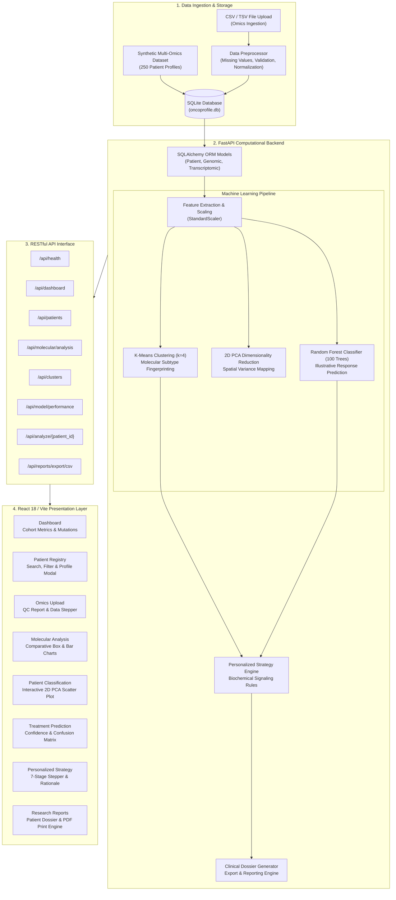

# ONCOPROFILE AI

### Multi-Omics Based Personalized Breast Cancer Treatment Strategy Platform

[](https://python.org)
[](https://fastapi.tiangolo.com)
[](https://react.dev)
[](https://www.typescriptlang.org)
[](https://vitejs.dev)
[](https://tailwindcss.com)
[](https://scikit-learn.org)
[](LICENSE)

> **CLINICAL RESEARCH & DECISION-SUPPORT NOTICE**  
> **ONCOPROFILE AI** is an advanced translational bioinformatics and precision oncology computational research prototype. All genomic variants, transcriptomic mRNA abundances, and treatment response classifications are simulated for educational evaluation and decision-support modeling. Proposed therapeutic pathways represent evidence-informed biochemical hypotheses designed to assist research inquiries and multidisciplinary review. **This system is not an FDA/CE-cleared diagnostic device and must not be used for direct clinical management or medical decision-making.**

---

## Table of Contents

- [1. Executive Summary](#1-executive-summary)
- [2. Biological Framework & Multi-Omics Features](#2-biological-framework--multi-omics-features)
  - [Genomic Somatic Drivers](#genomic-somatic-drivers)
  - [Transcriptomic Gene Signatures](#transcriptomic-gene-signatures)
  - [Clinical Immunohistochemical Biomarkers](#clinical-immunohistochemical-biomarkers)
- [3. System Architecture](#3-system-architecture)
- [4. Key Platform Capabilities](#4-key-platform-capabilities)
- [5. Application Screenshots](#5-application-screenshots)
- [6. Technology Stack](#6-technology-stack)
- [7. Machine Learning Methodology](#7-machine-learning-methodology)
  - [Synthetic Multi-Omics Cohort](#synthetic-multi-omics-cohort)
  - [Unsupervised Molecular Clustering & PCA](#unsupervised-molecular-clustering--pca)
  - [Supervised Response Classifier & Metrics](#supervised-response-classifier--metrics)
- [8. Installation & Execution Guide](#8-installation--execution-guide)
  - [Prerequisites](#prerequisites)
  - [Repository Setup](#repository-setup)
  - [Backend Setup & Database Seeding](#backend-setup--database-seeding)
  - [Frontend Setup & Compilation](#frontend-setup--compilation)
  - [Execution Option A: Unified Single-Port Launch (Recommended)](#execution-option-a-unified-single-port-launch-recommended)
  - [Execution Option B: Dual-Port Development Launch](#execution-option-b-dual-port-development-launch)
  - [Automated Verification Suite](#automated-verification-suite)
- [9. RESTful API Reference](#9-restful-api-reference)
- [10. Project Directory Structure](#10-project-directory-structure)
- [11. Alignment with UN Sustainable Development Goals](#11-alignment-with-un-sustainable-development-goals)
- [12. Scientific Limitations & Responsible Use](#12-scientific-limitations--responsible-use)
- [13. Future Roadmap](#13-future-roadmap)
- [14. License](#14-license)

---

## 1. Executive Summary

Breast cancer (*Carcinoma mammae*) is not a single uniform neoplasm, but an intricately heterogeneous spectrum of diseases governed by distinct somatic mutations, transcriptomic expression programs, and cell-surface receptor dynamics. Traditional clinical staging (TNM) alone often fails to account for biological diversity, leading to over-treatment or resistance to standard chemotherapeutic regimens.

**ONCOPROFILE AI** addresses this challenge by implementing an end-to-end translational precision-oncology workflow:

$$\text{Patient Sample} \longrightarrow \text{Multi-Omics Ingestion} \longrightarrow \text{Data Processing} \longrightarrow \text{Molecular Profiling} \longrightarrow \text{Spatial Classification} \longrightarrow \text{Response Prediction} \longrightarrow \text{Personalized Strategy}$$

The platform integrates multi-layered patient data (genomics, transcriptomics, and clinical immunohistochemistry), performs automated preprocessing and normalization, applies unsupervised spatial clustering (**K-Means** with **Principal Component Analysis**), evaluates therapeutic efficacy with a supervised machine learning classifier (**Random Forest**), and generates individualized, rule-based therapeutic strategies backed by biochemical rationale.

---

## 2. Biological Framework & Multi-Omics Features

The platform models multi-omics breast cancer heterogeneity across three biological tiers:

```
                                 [ MULTI-OMICS DATA TIERS ]
                                              │
         ┌────────────────────────────────────┼────────────────────────────────────┐
         ▼                                    ▼                                    ▼
┌──────────────────┐               ┌───────────────────────┐             ┌────────────────────┐
│     GENOMICS     │               │    TRANSCRIPTOMICS    │             │   CLINICAL IHC     │
│  Somatic Drivers │               │   Normalized mRNA     │             │ Receptor Dynamics  │
│  • BRCA1 / BRCA2 │               │   • ESR1   • PGR      │             │  • ER Status (±)   │
│  • PIK3CA        │               │   • ERBB2  • MKI67    │             │  • PR Status (±)   │
│  • TP53          │               │   • EGFR   • BRCA1    │             │  • HER2 Status (±) │
│  • ESR1          │               │   • BRCA2  • PIK3CA   │             │  • Ki-67 Index (%) │
│  • ERBB2 Amp     │               │  (log2 TPM+1 density) │             │  • Age & Stage     │
└──────────────────┘               └───────────────────────┘             └────────────────────┘
```

### Genomic Somatic Drivers
- **BRCA1 & BRCA2:** Crucial tumor suppressor genes that orchestrate the Homologous Recombination (HR) repair of DNA double-strand breaks. Inactivating pathogenic variants compromise genomic integrity, generating hyper-sensitivity to platinum salts and targetable **synthetic lethality** through Poly(ADP-ribose) Polymerase (**PARP**) inhibitors (e.g., olaparib, talazoparib).
- **PIK3CA:** Encodes the catalytic p110α subunit of phosphatidylinositol 3-kinase. Activating hot-spot variants (e.g., helical domain E542K/E545K, kinase domain H1047R) stimulate constitutive downstream AKT/mTOR signaling, driving endocrine therapy escape and indicating eligibility for alpha-selective PI3K inhibitors (alpelisib) or AKT inhibitors (capivasertib).
- **TP53:** The principal guardian of the genome. Mutations compromise G1/S cell-cycle checkpoint arrest and pro-apoptotic cascades, leading to marked chromosomal instability; highly prevalent in Triple-Negative Breast Cancer (>80%) and HER2-enriched tumors (>70%).
- **ESR1:** Encodes Estrogen Receptor Alpha (ERα). Acquired mutations in the ligand-binding domain (LBD, such as Y537S or D538G) confer constitutive, ligand-independent transcriptional activation, driving secondary resistance to aromatase inhibitors while retaining sensitivity to oral Selective Estrogen Receptor Degraders (**SERDs**, e.g., elacestrant).
- **HER2 / ERBB2 Amplification:** Somatic copy-number amplification of the receptor tyrosine kinase oncogene on chromosome 17q12, resulting in high cell-surface receptor density and aggressive proliferative drive.

### Transcriptomic Gene Signatures
Expressed in continuous $\log_2(\text{TPM} + 1)$ normalized abundance:
- **ESR1 Expression:** Quantifies functional estrogen receptor transcript density.
- **PGR Expression:** Progesterone receptor transcript; direct downstream target of ERα transcriptional activity, confirming an intact endocrine signaling axis.
- **ERBB2 Expression:** Quantifies *HER2* mRNA abundance, discriminating gene-amplified overexpression from basal expression.
- **MKI67 Expression:** Encodes the nuclear antigen Ki-67, expressed during active cell-cycle phases ($G_1, S, G_2, M$) and suppressed in $G_0$; correlates strongly with mitotic index and aggressive clinical courses.
- **EGFR Expression:** Epidermal Growth Factor Receptor transcript; canonical hallmark of basal-like triple-negative neoplasms.
- **BRCA1, BRCA2, & PIK3CA Expression:** Corroborates DNA damage response and signaling pathway expression levels.

### Clinical Immunohistochemical Biomarkers
- **Estrogen Receptor (ER) Status:** Positive / Negative (threshold: $\ge 1\%$ tumor nuclei staining).
- **Progesterone Receptor (PR) Status:** Positive / Negative.
- **HER2 Status:** Positive / Negative (concordant with IHC 3+ or FISH gene amplification ratio $\ge 2.0$).
- **Ki-67 Proliferation Index:** Proliferation fraction percentage ($4.0\% - 95.0\%$).
- **Age:** $30 - 82$ years.
- **Disease Stage:** AJCC TNM clinical stage (Stage I, Stage IIA, Stage IIB, Stage IIIA, Stage IIIB, Stage IV).

---

## 3. System Architecture

The following diagram illustrates the complete modular architecture, data flow, and runtime integration of **ONCOPROFILE AI**:



---

## 4. Key Platform Capabilities

| Module | Core Functionality | Verified Features |
|---|---|---|
| **Executive Dashboard** | Real-time cohort epidemiology & biomarker surveillance | Real-time stat cards, subtype distribution donut, disease staging bar chart, driver mutation prevalence rates, recent patient analyses with direct profile links. |
| **Patient Registry** | Multi-omics patient directory | Searchable table of 250 simulated patients, filtering by molecular subtype and disease stage, detailed profile modal (genomic mutations, expression values, clinical IHC), new patient intake form with live validation. |
| **Omics Upload & QC** | Ingestion pipeline & automated quality control | Drag-and-drop CSV upload, 22-column schema validation, missing-value imputation, categorical encoding, duplicate detection, and automated data quality scoring. |
| **Molecular Analysis** | Bioinformatics exploration & expression distributions | Transcriptomic mRNA expression comparison across subtypes, somatic mutation frequency matrix, Pearson correlation analysis, and Gini feature importance rankings. |
| **Patient Classification** | Unsupervised molecular grouping & spatial reduction | K-Means clustering ($k=4$), interactive 2D PCA scatter plot capturing ~60.9% variance, cluster centroid fingerprinting, and clear contrast between clinical IHC subtypes and exploratory mathematical clusters. |
| **Treatment Prediction** | Supervised therapeutic response inference | Random Forest classifier outputting three response classes (`Likely responder`, `Intermediate response`, `Lower predicted response`), class probability distributions, $3 \times 3$ confusion matrix, and performance metrics. |
| **Personalized Strategy** | Rule-based precision oncology decision engine | 7-stage translational workflow stepper, targeted therapeutic pathway recommendations, actionable enzyme/receptor targets, biochemical mechanism rationales, and clinical decision support disclaimers. |
| **Research Reports & Export** | Clinical documentation & reproducible data export | Individualized patient precision oncology dossiers, cohort-level summary reports, print-ready CSS formatting for PDF generation, and complete CSV export download (`/api/reports/export/csv`). |
| **About Platform** | Scientific methodology & public health alignment | Detailed overview of breast cancer heterogeneity, biological rationale for all selected biomarkers, computational design, and alignment with UN Sustainable Development Goal 3. |

---

## 5. Application Screenshots

The platform features a clean, light-only clinical research interface designed with Tailwind CSS, Recharts, and Lucide React icons.

Screenshot assets should be placed in `docs/screenshots/`:

| Target Screenshot | Recommended Interface View | Key Visual Elements to Capture |
|---|---|---|
| `docs/screenshots/dashboard.png` | Executive Analytics Dashboard | Cohort KPI cards, molecular subtype donut, mutation prevalence bars, recent analyses table. |
| `docs/screenshots/patient-registry.png` | Cohort Registry | Search bar, subtype/stage dropdowns, 250-record data table, and open Patient Detail modal. |
| `docs/screenshots/molecular-analysis.png` | Molecular Analysis Module | Comparative expression bar/box charts, genomic mutation frequencies, and correlation matrix. |
| `docs/screenshots/classification.png` | Patient Classification | Interactive 2D PCA scatter plot, variance explained indicators, and 4 cluster profile cards. |
| `docs/screenshots/treatment-prediction.png` | Treatment Prediction | Random Forest probability gauges, confusion matrix, model performance benchmarks, and feature importance. |
| `docs/screenshots/personalized-strategy.png` | Personalized Strategy Engine | 7-stage translational workflow stepper, targeted pathway proposals, and biochemical rationales. |

> **Instructions for Adding Screenshots:**  
> 1. Launch the application locally at `http://localhost:8000` (or `http://localhost:3000`).  
> 2. Navigate to each respective module in your browser.  
> 3. Capture clean desktop viewport screenshots and save them as PNG files matching the exact paths listed above into the `docs/screenshots/` directory.  
> 4. Once saved, Markdown image tags (e.g. ``) will immediately render the screenshots on GitHub.

---

## 6. Technology Stack

### Frontend Architecture
- **Framework:** [React 18.3](https://react.dev) with [TypeScript 5.6](https://www.typescriptlang.org)
- **Build Tool:** [Vite 5.4](https://vitejs.dev)
- **Styling:** [Tailwind CSS 3.4](https://tailwindcss.com) with PostCSS and Autoprefixer
- **Data Visualizations:** [Recharts 2.13](https://recharts.org) (Responsive containers, Donut charts, Bar charts, Scatter plots)
- **Icons:** [Lucide React 1.16](https://lucide.dev)

### Backend & API Framework
- **Runtime:** [Python 3.12](https://www.python.org)
- **Web Framework:** [FastAPI 0.110+](https://fastapi.tiangolo.com)
- **ASGI Server:** [Uvicorn 0.28+](https://www.uvicorn.org)
- **Data Validation & Schemas:** [Pydantic v2](https://docs.pydantic.dev)
- **Database ORM:** [SQLAlchemy 2.0](https://www.sqlalchemy.org)
- **Multipart Form Support:** [python-multipart 0.0.9](https://github.com/Kludex/python-multipart)

### Database & Storage
- **Database Engine:** [SQLite 3](https://sqlite.org) (`backend/data/oncoprofile.db`)
- **Data Format:** CSV flat-file datasets (`backend/data/synthetic_breast_cancer_omics.csv`)

### Machine Learning & Scientific Computing
- **Core ML Library:** [Scikit-learn 1.4](https://scikit-learn.org) (`RandomForestClassifier`, `StandardScaler`, `PCA`, classification metrics)
- **Clustering Engine:** [SciPy 1.12](https://scipy.org) (`scipy.cluster.vq.kmeans2` vector quantization)
- **Array Processing:** [NumPy 1.26](https://numpy.org)
- **Dataframes & Tabular Analysis:** [Pandas 2.2](https://pandas.pydata.org)

---

## 7. Machine Learning Methodology

### Synthetic Multi-Omics Cohort
The project includes a reproducible synthetic dataset of **250 breast cancer patients** (`backend/data/synthetic_breast_cancer_omics.csv`) generated with fixed random seed `42` (`backend/app/synthetic_data.py`). Subtype distributions mirror empirical clinical prevalence:
- **Luminal A ($\approx 40\%$):** $ER^+/PR^+$, $HER2^-$, low Ki-67 ($<20\%$), high *PIK3CA* mutation rate, indolent biology.
- **Luminal B ($\approx 25\%$):** $ER^+$, variable $PR$, elevated proliferation (Ki-67 $\ge 20\%$) or $HER2^+$.
- **HER2-Enriched ($\approx 15\%$):** $ER^-/PR^-$, marked *ERBB2* mRNA/gene amplification, high *TP53* mutation prevalence.
- **Triple-Negative Breast Cancer ($\approx 20\%$):** $ER^-/PR^-/HER2^-$, high *EGFR* and *MKI67*, high *TP53* and *BRCA1/2* variants.

### Unsupervised Molecular Clustering & PCA
1. **Feature Selection (11 Features):**
   `esr1_expression`, `pgr_expression`, `erbb2_expression`, `mki67_expression`, `egfr_expression`, `brca1_expression`, `brca2_expression`, `pik3ca_expression`, `pik3ca_mutation`, `tp53_mutation`, `her2_amplification`.
2. **Standardization:** Zero-mean, unit-variance scaling using `StandardScaler`.
3. **K-Means Clustering ($k=4$):** Vector quantization clustering identifies four biologically distinct mathematical profiles:
   - **Cluster 1:** *Luminal-Low Proliferation Profile* (High *ESR1/PGR*, low Ki-67).
   - **Cluster 2:** *HER2-Driven Oncogenic Profile* (High *ERBB2* expression & amplification).
   - **Cluster 3:** *Basal-like / Genomic Instability Profile* (*EGFR/MKI67* high, *TP53/BRCA* mutated).
   - **Cluster 4:** *Luminal Proliferative / Intermediate Profile* (Hormone-positive with elevated Ki-67 $\ge 20\%$).
4. **2D Principal Component Analysis (PCA):**
   Reduces 11-dimensional feature space to 2 orthogonal components for visualization:
   - **Principal Component 1 ($PC_1$):** Explains **42.4%** of variance (primarily captures endocrine vs basal/proliferative axis).
   - **Principal Component 2 ($PC_2$):** Explains **18.5%** of variance (primarily captures HER2 amplification axis).
   - **Total Explained Variance:** **60.9%**.

### Supervised Response Classifier & Metrics
A **Random Forest Classifier** (`n_estimators=100`, `max_depth=6`, `random_state=42`) predicts simulated therapeutic response categories (`Likely responder`, `Intermediate response`, `Lower predicted response`) across 16 predictive features (genomics, transcriptomics, age, and Ki-67 index).

Evaluated on a **stratified 20% hold-out test set** ($n=50$), the model achieves:

| Metric | Score | Note |
|---|---|---|
| **Test Accuracy** | **58.0%** | Stratified 50-patient test split |
| **Macro Precision** | **71.7%** | Unweighted mean across response classes |
| **Macro Recall** | **55.8%** | Sensitivity across multi-class distribution |
| **Macro F1-Score** | **60.7%** | Harmonic mean of precision and recall |
| **Weighted F1-Score** | **58.3%** | Support-weighted multi-class score |

#### Confusion Matrix ($n=50$ Test Cases)
```
                          Predicted
                   Likely   Interm   Lower
Actual  Likely   [   15       12       0   ]
        Interm   [    8       13       0   ]
        Lower    [    0        1       1   ]
```

#### Gini Feature Importance Breakdown
```
esr1_mutation        ████████████████████████ 24.1%
age                  ██████████ 10.1%
pgr_expression       █████████ 9.2%
pik3ca_expression    █████████ 8.7%
ki67_percent         ████████ 7.8%
egfr_expression      ███████ 7.4%
brca1_expression     ███████ 7.1%
mki67_expression     ███████ 6.6%
esr1_expression      ██████ 5.7%
brca2_expression     █████ 5.3%
erbb2_expression     █████ 4.9%
tp53_mutation        █ 1.3%
pik3ca_mutation      █ 0.7%
brca2_mutation       ▏ 0.5%
her2_amplification   ▏ 0.4%
brca1_mutation       ▏ 0.2%
```

> **Evaluation Clarification:**  
> These metrics demonstrate internal consistency of the classification pipeline across calibrated multi-omics features. **Model performance on simulated datasets does not establish clinical predictive validity.**

---

## 8. Installation & Execution Guide

### Prerequisites
- **Operating System:** Windows 10/11, macOS, or Linux (Windows 11 Command Prompt instructions shown below).
- **Python:** Python 3.10+ (Python 3.12 verified).
- **Node.js:** Node.js 18+ with `npm`.
- **Git:** Git installed and accessible from command line.

---

### Repository Setup
Open Windows Command Prompt (`cmd.exe`) and clone the repository:

```cmd
git clone https://github.com/RAMKISHORMB/ONCOPROFILE-AI.git
cd ONCOPROFILE-AI
```

---

### Backend Setup & Database Seeding
Install Python dependencies and initialize the SQLite database with the 250 synthetic patient cohort:

```cmd
python -m pip install -r backend\requirements.txt
python backend\seed_db.py
```

Expected output:
```
[ONCOPROFILE AI] Seeding database at backend\data\oncoprofile.db...
[ONCOPROFILE AI] Inserted 250 patient records, profiles, and initial analyses.
[ONCOPROFILE AI] Database seeding completed successfully.
```

---

### Frontend Setup & Compilation
Install frontend npm packages and compile the production client:

```cmd
cd frontend
npm.cmd install
npm.cmd run build
cd ..
```

---

### Execution Option A: Unified Single-Port Launch (Recommended)
This serves both the FastAPI backend APIs and the compiled React single-page application on a single port (**`http://localhost:8000`**):

Using the provided batch script:
```cmd
run_single_port.cmd
```

*Or via direct Python command line:*
```cmd
python -m uvicorn app.main:app --app-dir backend --host 127.0.0.1 --port 8000
```

- **Web Application:** **`http://localhost:8000`**
- **Interactive Swagger API Docs:** **`http://localhost:8000/docs`**
- **ReDoc API Specification:** **`http://localhost:8000/redoc`**

---

### Execution Option B: Dual-Port Development Launch
For active development with hot-module reloading across both frontend and backend:

#### Terminal 1 — FastAPI Backend (Port 8000)
```cmd
run_backend.cmd
```
*Or:*
```cmd
python -m uvicorn app.main:app --app-dir backend --host 127.0.0.1 --port 8000 --reload
```

#### Terminal 2 — Vite Development Server (Port 3000)
```cmd
run_frontend.cmd
```
*Or:*
```cmd
cd frontend
npm.cmd run dev
```

- **Frontend Interface:** **`http://localhost:3000`**
- **Backend API:** **`http://localhost:8000`**

---

### Automated Verification Suite
Run the automated test suite to verify server endpoints, database connections, and machine learning models:

```cmd
python backend\test_api.py
```

Expected output:
```
[ONCOPROFILE AI] ML Pipeline fitted successfully on 250 synthetic records.
[TEST 1/5] Health: online
[TEST 2/5] Total Patients: 250, Subtypes: ['Luminal A', 'Triple-Negative (TNBC)', 'HER2-enriched', 'Luminal B']
[TEST 3/5] Model Accuracy: 58.0%, Macro F1: 0.607
[TEST 4/5] ONC-001 Analysis:
           - Subtype: Luminal A
           - Cluster: Cluster 1: Luminal-Low Proliferation Profile
           - Predicted Response: Likely responder (72.9%)
           - Potential Pathways: ['Endocrine Backbone Therapy', 'PI3K/AKT/mTOR Targeted Pathway']
           - Stages count: 7
[TEST 5/5] Report retrieved successfully. Title: Luminal A Strategy Report

>>> ALL API VERIFICATION TESTS COMPLETED SUCCESSFULLY! <<<
```

---

## 9. RESTful API Reference

The FastAPI backend exposes standard REST endpoints documented via OpenAPI:

| Method | Endpoint | Description | Request / Query Parameters |
|---|---|---|---|
| `GET` | `/api/health` | Service health status and ML model operational state. | None |
| `GET` | `/api/dashboard` | Aggregated cohort metrics, subtype counts, and mutation rates. | None |
| `GET` | `/api/patients` | Paginated cohort registry with multi-omics profiles. | `subtype`, `stage`, `search` |
| `POST` | `/api/patients` | Registers a new patient record and associated omics. | JSON body (`PatientCreate`) |
| `GET` | `/api/patients/{patient_id}` | Full genomic, transcriptomic, and IHC data for a patient. | Path parameter `patient_id` |
| `POST` | `/api/omics/upload` | Uploads and processes a new multi-omics dataset file. | Multipart form file (CSV) |
| `GET` | `/api/omics/quality-report` | Data quality score, missingness report, and processing log. | None |
| `GET` | `/api/molecular/analysis` | Cohort-level expression distributions and mutation rates. | None |
| `GET` | `/api/clusters` | K-Means cluster centroids, patient assignments, and PCA coords. | None |
| `GET` | `/api/model/performance` | Random Forest metrics, confusion matrix, and feature importances. | None |
| `POST` | `/api/model/predict/{patient_id}` | Runs model inference for a specific patient. | Path parameter `patient_id` |
| `POST` | `/api/analyze/{patient_id}` | Executes 7-stage pipeline and generates strategy for a patient. | Path parameter `patient_id` |
| `GET` | `/api/patients/{patient_id}/strategy` | Retrieves existing personalized strategy report. | Path parameter `patient_id` |
| `GET` | `/api/reports/{patient_id}` | Formatted precision oncology clinical dossier data. | Path parameter `patient_id` |
| `GET` | `/api/reports/export/csv` | Downloads complete cohort dataset as CSV. | None |

---

## 10. Project Directory Structure

```
ONCOPROFILE-AI/
├── .gitignore                          # Git exclusions (pycache, node_modules, dist)
├── README.md                           # Master project documentation
├── run_backend.cmd                     # Batch script: starts FastAPI server on port 8000
├── run_frontend.cmd                    # Batch script: starts Vite dev server on port 3000
├── run_single_port.cmd                 # Batch script: unified hosting on port 8000
│
├── backend/                            # FastAPI backend services
│   ├── requirements.txt                # Python backend dependencies
│   ├── seed_db.py                      # Database seeding script (250 synthetic records)
│   ├── test_api.py                     # Automated API verification test suite
│   │
│   ├── app/                            # Application package
│   │   ├── __init__.py                 # Package initializer
│   │   ├── database.py                 # SQLAlchemy SQLite engine, session, and Base
│   │   ├── data_processor.py           # Missing value imputation, normalization, QC
│   │   ├── main.py                     # FastAPI app, static SPA mounting, dashboard API
│   │   ├── ml_pipeline.py              # K-Means, PCA, Random Forest, StandardScaler
│   │   ├── models.py                   # SQLAlchemy ORM models (Patient, Omics, Strategy)
│   │   ├── schemas.py                  # Pydantic v2 validation models
│   │   ├── strategy_engine.py          # Rule-based precision oncology strategy generator
│   │   ├── synthetic_data.py           # Synthetic cohort generator (seed 42, 250 profiles)
│   │   │
│   │   └── routers/                    # Modular API route controllers
│   │       ├── __init__.py             # Routers package initializer
│   │       ├── analysis.py             # Molecular analysis & pipeline runner endpoints
│   │       ├── classification.py       # Clustering & PCA scatter coordinates
│   │       ├── omics.py                # CSV upload & data quality reporting
│   │       ├── patients.py             # Patient CRUD, filtering, and registry
│   │       ├── prediction.py           # Response classifier metrics & prediction
│   │       ├── reports.py              # Clinical dossier & CSV export
│   │       └── strategy.py             # Personalized strategy retrieval
│   │
│   └── data/                           # Dataset storage
│       ├── dataset_documentation.md    # Detailed data dictionary and biomarker specifications
│       ├── oncoprofile.db              # SQLite relational database
│       └── synthetic_breast_cancer_omics.csv # 250-patient multi-omics benchmark dataset
│
├── docs/                               # Project documentation assets
│   └── screenshots/                    # Application UI screenshot images
│
└── frontend/                           # React 18 / TypeScript frontend
    ├── index.html                      # HTML5 root template
    ├── package.json                    # Frontend package dependencies & scripts
    ├── postcss.config.js               # PostCSS configuration
    ├── tailwind.config.js              # Tailwind CSS design system configuration
    ├── tsconfig.json                   # TypeScript compiler options
    ├── vite.config.ts                  # Vite build tool configuration
    │
    ├── dist/                           # Compiled production static bundle
    │   ├── index.html                  # Minified HTML entry point
    │   └── assets/                     # Bundled JS and CSS chunks
    │
    └── src/                            # React application source code
        ├── api.ts                      # Axios/fetch API client abstraction
        ├── App.tsx                     # Main layout & router state container
        ├── index.css                   # Global styles & Tailwind directives
        ├── main.tsx                    # React DOM entry point
        ├── types.ts                    # TypeScript interfaces for omics & clinical models
        │
        ├── components/                 # Reusable UI component library
        │   ├── AlertBanner.tsx         # Clinical disclaimers & alert cards
        │   ├── MetricCard.tsx          # Key performance indicator cards
        │   ├── Navbar.tsx              # Top clinical navigation header
        │   ├── Sidebar.tsx             # Collapsible primary navigation sidebar
        │   └── WorkflowStepper.tsx     # 7-stage translational pipeline progress bar
        │
        └── pages/                      # Platform module pages
            ├── AboutResearchPage.tsx   # Biological rationale & SDG 3 documentation
            ├── DashboardPage.tsx       # Executive analytics & cohort overview
            ├── MolecularAnalysisPage.tsx # Comparative expression & mutation frequency
            ├── OmicsUploadPage.tsx     # File ingestion & data quality report
            ├── PatientClassificationPage.tsx # K-Means clustering & 2D PCA scatter plot
            ├── PatientRegistryPage.tsx # Patient table, search/filter & profile modal
            ├── PersonalizedStrategyPage.tsx  # 7-stage strategy engine & rationale
            ├── ResearchReportsPage.tsx # Clinical dossiers & PDF export engine
            └── TreatmentPredictionPage.tsx # Random Forest inference & confusion matrix
```

---

## 11. Alignment with UN Sustainable Development Goals

**United Nations Sustainable Development Goal 3:**  
*Ensure healthy lives and promote well-being for all at all ages.*

- **Target 3.4:** *By 2030, reduce by one-third premature mortality from non-communicable diseases through prevention and treatment and promote mental health and well-being.*
- **Translational Relevance:** Breast cancer represents a primary global burden of cancer mortality. Non-targeted systemic chemotherapy frequently causes substantial toxicity while offering limited benefit in biomarker-negative or resistant subsets. By implementing multi-omics biomarker-stratified precision oncology (such as evaluating PARP inhibitors in *BRCA1/2*-mutated tumors, dual anti-HER2 blockade in *ERBB2*-amplified neoplasms, and selective PI3K inhibitors in *PIK3CA*-mutated hormone-receptor-positive disease), clinical pipelines can optimize therapeutic selection and avert ineffective toxicities.

---

## 12. Scientific Limitations & Responsible Use

> ### Important Operational Notice
> 1. **Educational & Research Scope:** **ONCOPROFILE AI** is an academic software demonstration and research prototype. It is designed to illustrate bioinformatics concepts, data integration pipelines, and computational decision-support workflows.
> 2. **Synthetic Dataset:** All 250 patient records in `synthetic_breast_cancer_omics.csv` are synthetically generated for testing and demonstration. **They do not represent real human subjects, validated electronic health records, or clinical trial outcomes.**
> 3. **Illustrative Machine Learning:** The Random Forest response classifier and K-Means clustering algorithm are trained on synthetic data. Classification metrics, confusion matrices, and confidence scores reflect internal mathematical behavior on simulated data and **must not be interpreted as evidence of clinical predictive efficacy.**
> 4. **No Medical Decisions:** The proposed therapeutic strategies, pathway targets, and clinical notices are illustrative scientific examples. **No patient diagnosis, treatment selection, or clinical decision should ever be based on outputs from this application.**
> 5. **Regulatory Status:** This system has not been submitted to, reviewed by, or approved by the FDA, EMA, or any national medical regulatory authority.

---

## 13. Future Roadmap

- [ ] **Real-World Cohort Validation:** Validate computational pipelines against governed, de-identified clinical datasets (e.g., [The Cancer Genome Atlas - TCGA-BRCA](https://portal.gdc.cancer.gov) and [METABRIC](https://cbioportal.org)).
- [ ] **External Model Validation:** Benchmark response classification models across independent multi-center cohorts to evaluate generalization performance.
- [ ] **Advanced Explainable AI (XAI):** Integrate SHAP (SHapley Additive exPlanations) and LIME to generate per-patient local feature attributions and transparent decision trees.
- [ ] **Multi-Omics Expansion:** Incorporate copy-number variation (CNV) segmentation, whole-exome tumor mutational burden (TMB), Homologous Recombination Deficiency (HRD) genomic scar scores, DNA methylation arrays, and mass spectrometry phosphoproteomics.
- [ ] **FHIR & Clinical Standards Integration:** Implement HL7 FHIR Genomics REST interfaces for standards-compliant electronic health record interoperability.
- [ ] **Multidisciplinary Tumor Board Workflows:** Implement collaborative case review modules with clinician audit logging and multidisciplinary voting workflows.

---

## 14. License

This project is licensed under the **MIT License**. See the [LICENSE](LICENSE) file for details.
